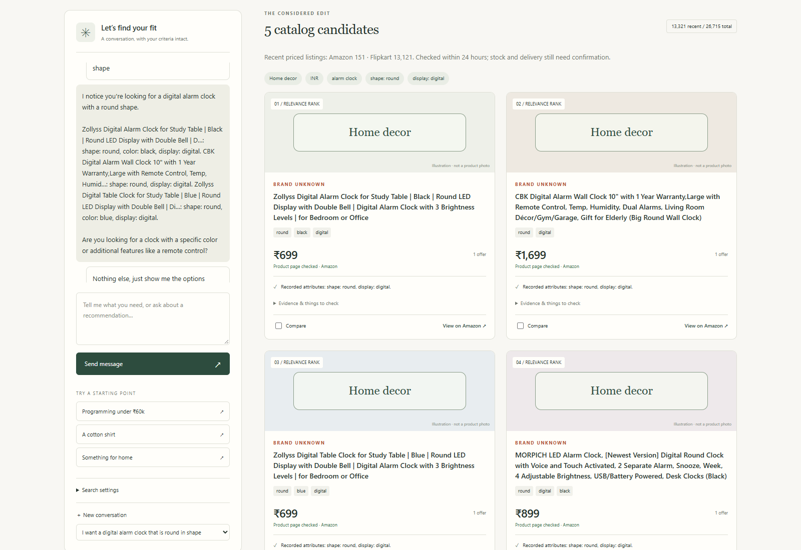
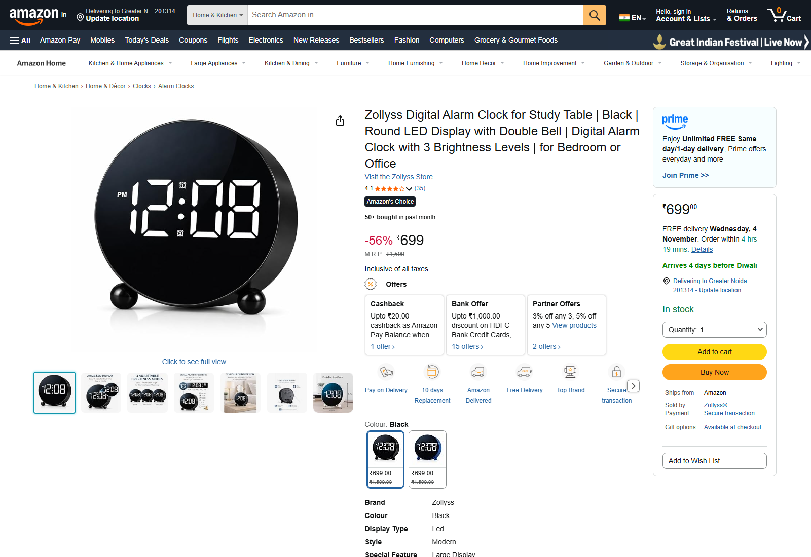
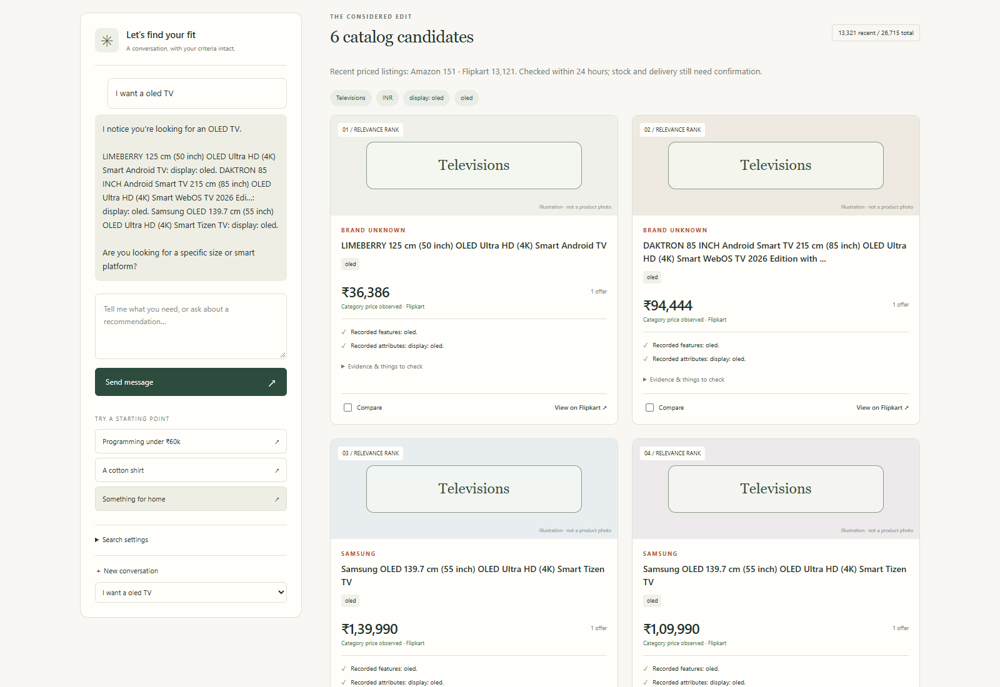
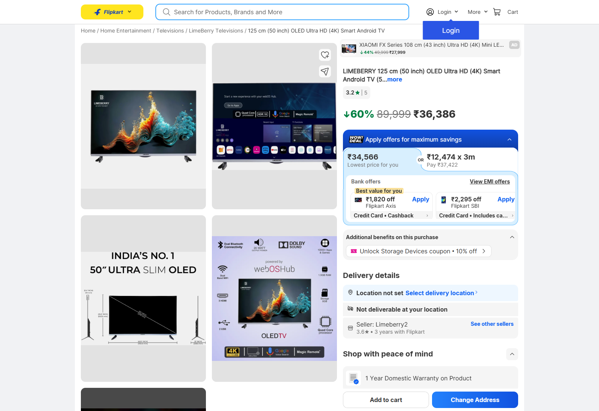
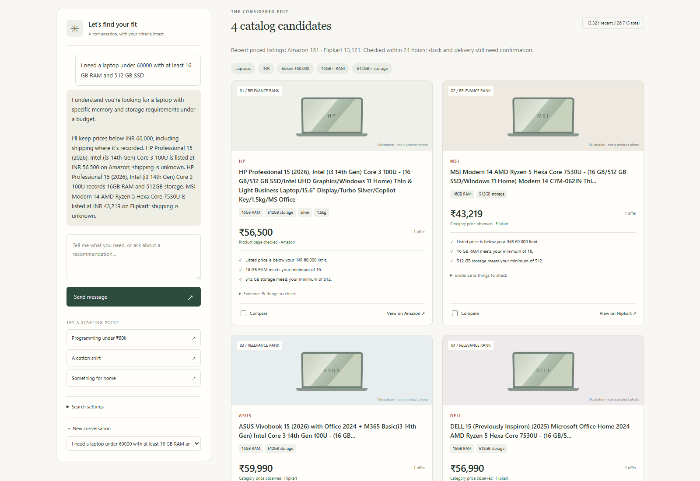
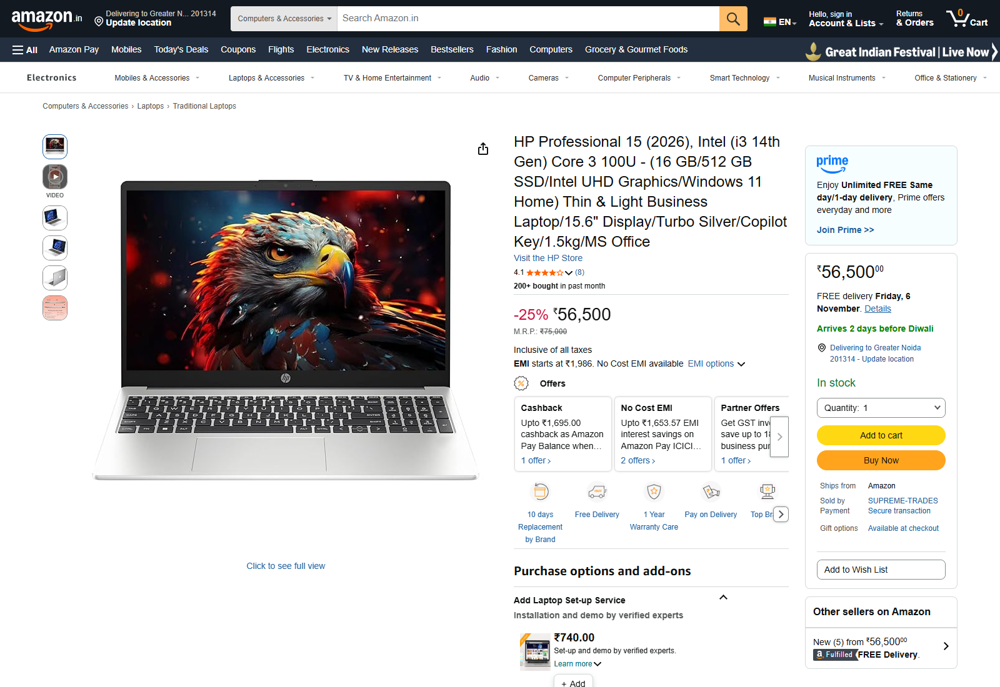

# Agentic Affiliate Shopping Platform

**Shortlist — a local AI shopping assistant for shopping across Indian retailers.**

The latest development catalog contains **57,361 retailer listings across Amazon India, Flipkart and Reliance Digital**, covering **23 category groups** as of 3 November 2026. See the [catalog expansion record](docs/CATALOG_EXPANSION.md) for coverage, validation and published-code availability.

Describe what you need, refine it through conversation, and compare a shortlist whose prices, specifications and source links remain visible.

[Search examples and screenshots](docs/SHOWCASE.md) · [Setup](docs/SETUP.md) · [Architecture](docs/ARCHITECTURE.md) · [Data format](docs/DATA.md) · [Catalog expansion](docs/CATALOG_EXPANSION.md)

## Business case

Shopping often starts with a need rather than a model number: a round digital alarm clock, an affordable laptop with enough memory, or a cotton shirt within a budget. Turning that need into a purchase usually involves repeated keyword searches, retailer filters, specification checks and multiple browser tabs. Comparing stores adds another layer of work.

The business idea is to make that discovery process conversational. A shopper describes their priorities, the platform preserves those requirements, and it produces a smaller set of candidates with reasons and source evidence. A follow-up such as “less than 1000” should refine the existing search rather than restart it or become a vague price suggestion.

The intended revenue model is affiliate referral commission after the relevant retailer approvals are obtained. Ranking should remain based on the shopper's requirements and recorded product information, with affiliate relationships disclosed. **Affiliate tracking is not active in this version:** purchase buttons are ordinary retailer links, and this project does not claim revenue, conversion improvements or retailer partnerships.

## Project plan

This rebuild continues the idea from [LLM Amazon Affiliate Business](https://github.com/adiltemp908-cyber/Adil_Muhammed-Agentic_Affiliate_Marketing). The original work explored an Amazon dataset, semantic search and a LangGraph flow. The new implementation broadens the retailer and category scope, runs language inference locally, and treats freshness and hard requirements as core parts of retrieval.

The platform implements its own collection, normalization, filtering and ranking. It does not obtain a ready-made shortlist from a paid shopping-search API. Local inference also means there is no hosted LLM bill for each conversation, although inference still uses local hardware and product collection requires internet access.

## Steps taken to reach the current version

### 1. Review the original prototype

The rebuild started by examining the old notebooks, catalog and repository. The main gaps were stale product observations, unreliable follow-up handling, Amazon-only assumptions, inconsistent price/specification enforcement, and no cohesive shopping application entry point.

### 2. Build a standalone application and offer model

The notebook prototype became a Python package, local HTTP service and browser interface. SQLite stores retailer offers separately from conversation checkpoints. Typed records keep product identity, currency, availability, observation time, source evidence and unknown values explicit.

### 3. Add cross-retailer catalog acquisition

The published Amazon and Flipkart adapters collect supported public product observations. The expanded development workspace also collects Reliance Digital observations, including direct product refresh and bounded collection-page discovery. Flipkart category traversal provides broad discovery; Amazon discovery checks individual product pages after finding their URLs. Known-product refresh and linked-product discovery provide additional paths when search pages are unavailable.

Collectors use bounded requests, source-policy checks, canonical product IDs and visible failures. Category-card prices are distinguished from product-detail checks. A successful page check is not a guarantee of delivery, variant availability or final checkout price.

### 4. Replace hosted inference with local models

The conversation uses **Qwen3-4B-Instruct-2507, Q4_K_M**, served through a local llama.cpp runtime. MiniLM sentence embeddings run locally for semantic retrieval. The first development environment reused model assets from the EvidenceAtlas project; this repository accepts independently configured model paths and does not require that project or contain its weights.

### 5. Make shopping a persistent conversation

LangChain composes prompts and parses structured model output. LangGraph manages the understand, clarify, retrieve and respond stages, with SQLite checkpoints for follow-ups and resumed conversations.

The model interprets intent and proposes preference changes. Explicit requirements become hard constraints. Inferred suggestions, such as a starting budget for “cheap,” are labeled separately and influence ranking without silently excluding other options.

### 6. Build retrieval around requirements

The search engine first applies category, freshness, budget and recorded specification constraints. It then ranks eligible offers using BM25, local embedding similarity, or a hybrid of both through reciprocal-rank fusion.

Unknown facts do not satisfy mandatory filters. Exact cross-store grouping is conservative, so similar-looking variants are not automatically merged. Price comparisons retain uncertainty about shipping and availability.

### 7. Correct conversational edge cases

Regression work addressed repeated clarification questions, lost preferences, “any budget,” confirmation phrases being mistaken for brands, and exclusive price ceilings. “Less than ₹1,000” is represented as a strict maximum of ₹1,000; it is not changed into a soft starting budget of ₹999.

Replies use recorded catalog facts, with model-assisted conversational phrasing. The model does not invent product prices or specifications to fill gaps.

### 8. Expand categories and repair catalog interpretation

Collection expanded beyond laptops into phones, TVs, clothing, footwear, home, kitchen, personal care, sports, toys, books, groceries and accessories. November collection runs added 30,646 net listings to the 31 October baseline, including 960 Reliance Digital listings and a final 13,903-listing Flipkart expansion across 89 departments. Targeted OLED collection revealed a second issue: the model could understand OLED while the catalog lacked the display field used by filtering. Extraction and matching now share that field and distinguish OLED, QLED, AMOLED and other panel types.

Retailer department evidence also helps distinguish rice containers from rice, and fridge bottles from refrigerators. Explicit components and warranty plans are kept out of whole-product recommendations or physical-product discovery as appropriate.

### 9. Build an inspectable shopping interface

The interface shows the conversation, saved criteria, retailer offers, evidence, unknowns, comparison controls and catalog coverage. Empty results explain a possible catalog/specification gap rather than claiming that no suitable product exists in stores.

### 10. Validate behavior and prepare a clean repository

The published source baseline recorded **162 passing regression tests** on 31 October. The expanded development workspace recorded **293 passing tests** and **14 hybrid search checks** on 3 November; these results apply to that workspace, as detailed in the [validation record](docs/VALIDATION.md). Live browser checks exercise local-model interpretation, hybrid search, retained constraints, price refinements and persisted state. The [showcase](docs/SHOWCASE.md) contains actual application captures, including a round digital alarm clock search.

This repository includes application source, tests, reusable collection tools, configuration examples and selected documentation. Generated databases, chat histories, runtime keys, model weights, embeddings, raw scraped pages and development reports are excluded.

## Current development snapshot

Measured on **3 November 2026 at 10:25 IST** in the populated development workspace:

| Measure | Snapshot |
|---|---:|
| Total retailer listings | 57,361 |
| Category groups, including Other | 23 |
| Observations within the preceding 24 hours | 23,104 |
| Recent priced listings, not marked unavailable | 22,841 |
| Explicitly historical records | 12,236 |

| Retailer | Total listings | Recent priced, not marked unavailable |
|---|---:|---:|
| Amazon India | 12,572 | 0 |
| Flipkart | 43,829 | 22,144 |
| Reliance Digital | 960 | 697 |

Amazon observations had aged beyond the 24-hour window by this validation; zero recent listings does not mean Amazon has no products. Reliance Digital's remaining 263 recent listings were marked unavailable and excluded from normal recommendations.

These are dated observations, not live inventory or a count of distinct physical products. Category-card prices do not establish stock, postcode delivery, selected size or checkout price. **The populated catalog is not bundled in the repository**; a fresh checkout starts empty. The [expansion record](docs/CATALOG_EXPANSION.md) includes category totals, collection history and a machine-readable snapshot.

**Published-code scope:** this documentation update records the newer development catalog. This checkout still provides the Amazon/Flipkart implementation and the `broad`/`extended` collection profiles. Reliance Digital support and the `more`, `additional` and `further` profiles are present in the development workspace but have not been ported into this published source tree. Follow [Setup](docs/SETUP.md) for commands available here. The screenshots below retain their original 31 October capture date.

## Example searches and product pages

Captured on **31 October 2026** from the running application. Each search is followed by the retailer page opened from its **top result**. These are real browser captures; prices and availability can change. See the [full showcase](docs/SHOWCASE.md) for the recorded criteria and details.

### Round digital alarm clock

**Request:** “I want a digital alarm clock that is round in shape”



**Top result opened on Amazon:** [Zollyss round digital alarm clock](https://www.amazon.in/dp/B0GJSWLRJ4).



### OLED television

**Request:** “I want a oled TV”



**Top result opened on Flipkart:** [LIMEBERRY 50-inch television](https://www.flipkart.com/limeberry-125-cm-50-inch-oled-ultra-hd-4k-smart-android-tv/p/itm1a9381dece63e?pid=TVSGMWP2WVG2CBSZ). OLED is the retailer's recorded claim. The page shows a delivery restriction with no location selected.



### Laptop below ₹60,000 with minimum specifications

**Request:** “I need a laptop under 60000 with at least 16 GB RAM and 512 GB SSD”



**Top result opened on Amazon:** [HP Professional 15 with 16 GB RAM and 512 GB SSD](https://www.amazon.in/dp/B0GHSN1N24).



## Run locally

The tested local-model runtime uses Windows and an NVIDIA GPU exposed through llama.cpp's Vulkan backend. Model weights and a compatible runtime are installed separately. See [Setup](docs/SETUP.md) for the full configuration, collection and indexing steps.

```powershell
git clone https://github.com/adiltemp908-cyber/Agentic_Affiliate_Shopping_Platform.git
cd Agentic_Affiliate_Shopping_Platform
python -m venv .venv
.\.venv\Scripts\Activate.ps1
python -m pip install -e ".[dev]"
```

After configuring the local models and collecting/importing a catalog:

```powershell
python -m shortlist index
python -m shortlist serve
# Open http://127.0.0.1:8777
```

The Windows launchers are optional conveniences. `Open Shortlist.cmd` opens the app; `Close Shortlist.cmd` stops the app and its owned model process. Use the same Python environment where dependencies were installed.

## Repository layout

```text
shortlist/        Catalog, acquisition, retrieval, conversation and local server
web/              Browser interface
tests/            Regression tests with isolated test data
scripts/          Reusable collection and screenshot capture tools
config/           Public category seeds and example model manifest
docs/             Setup, architecture, imports, catalog expansion and screenshot showcase
data/, models/    Empty runtime directories; generated contents are ignored
```

## Validation

```powershell
python -m pytest -q
```

See the [dated validation record](docs/VALIDATION.md) for the published baseline and expanded development results. Unit tests run without retailer access or downloaded model weights. Live examples require a populated recent catalog and configured local models. The screenshot capture script validates both the saved requirements and returned products before taking each image. These are regression and demonstration checks, not an independent benchmark of shopping recommendation quality.

## Current limitations and next steps

- Coverage is uneven and depends on accessible sources. HTTP failures, removed listings and markup changes can interrupt collection. There is no continuously refreshed marketplace-wide feed.
- Retailer claims are not independent product testing. Battery life, review synthesis, delivery promises and many subjective needs remain unsupported.
- Variant identity, selected sizes, stock and shipping are sometimes incomplete. Cross-store grouping is strongest for complete laptop variants.
- The local model can misunderstand requests; validation and visible fallbacks reduce errors but do not guarantee natural conversation on every phrasing.
- The service is designed for a single user on localhost. Public hosting, authentication, affiliate integration and autonomous evidence-acquisition planning remain future work.

The next useful milestones are stronger specification sources, scheduled bounded refresh, independently judged relevance evaluation, and approved affiliate-link integration with clear disclosure.
