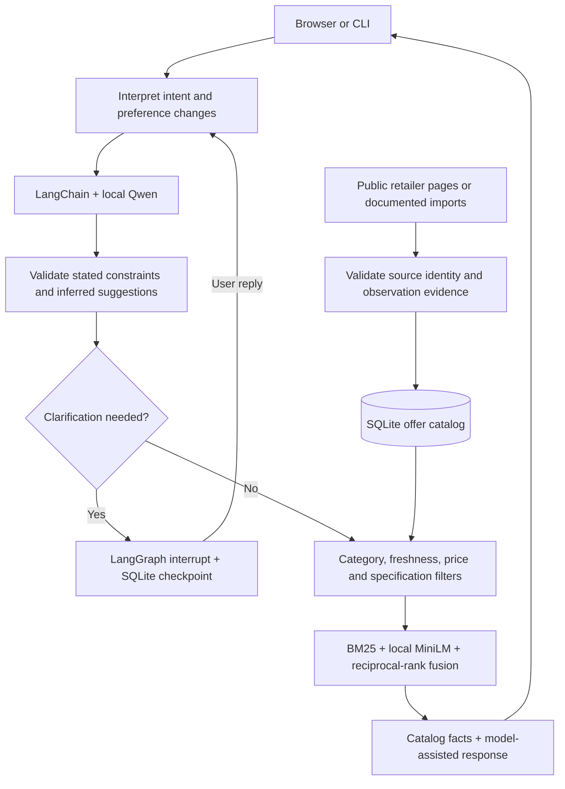

# Architecture

## Responsibilities

| Module | Role |
|---|---|
| `schema.py`, `interpretation.py`, `preferences.py` | Typed offers/preferences, structured change validation and explicit-rule fallback |
| `workflow.py` | LangGraph intent routing, clarification, checkpoints and response composition |
| `local_model.py` | App-owned llama.cpp process, LangChain prompts/parsers, local inference |
| `catalog.py` | SQLite persistence, URL canonicalization, freshness and conservative variant identity |
| `ingest.py`, `acquisition.py`, `detail_specs.py` | Retailer extraction, bounded discovery and primary-product evidence |
| `taxonomy.py` | Category routing, literal attribute normalization and documented GPU policy |
| `search.py` | Constraint filtering, BM25, local embeddings, fusion, grouping and result evidence |
| `server.py`, `web/` | Local API, conversation interface, comparison view and catalog tools |

## Where LangChain and LangGraph help

LangChain combines prompts, local inference runnables and typed output parsing. LangGraph keeps the shopping state across turns and can pause for clarification before continuing. Neither framework supplies product data, proves a claim, or enforces the budget; those responsibilities belong to the application.

The model supplies **preference changes and conversational choices**, not product facts. Stated constraints remain hard filters. Inferred budgets/specifications are separate, adjustable suggestions. Replies select allowed fact IDs and render recorded evidence rather than asking the model to invent a recommendation justification.

This is a controlled stateful workflow rather than an open-ended autonomous agent. Catalog acquisition is a separate user-triggered operation, not a tool loop the model independently plans during a search.

## Catalog expansion

The [3 November development snapshot](CATALOG_EXPANSION.md) records 57,361 listings across three retailers and 23 category groups. The published source still implements Amazon and Flipkart; Reliance Digital support is currently in the development workspace. Its collector validates collection-card identity against embedded product state, uses an explicit INR selling price with equal minimum/maximum values, and records unavailable products separately. Collection observations retain their source limitations and do not imply checkout stock.

Broader department collection increases candidate coverage while freshness and mandatory filters continue to control eligibility. Metadata corrections preserve original observation timestamps; collection and index rebuilds are separate operations when indexing is deferred. Aggregate catalog size is not a recommendation-quality metric.

## Data and ranking

`catalog.sqlite3` stores offers and source-check logs. `conversations.sqlite3` stores checkpoints. `embeddings.npz` stores normalized vectors, text signatures and a catalog fingerprint. Runtime storage is excluded from version control.

Recent means observed within 24 hours. Historical data is excluded from normal search; research mode can include it with a warning. A recent category-card observation does not prove selected size, delivery, stock or final checkout cost. Unknown mandatory attributes cannot satisfy a requested filter.

BM25 and embedding similarity rank the same eligible set. Hybrid retrieval combines rank positions using reciprocal-rank fusion. Recorded priorities and disclosed assumptions can affect ordering. There is no commission or sponsored-placement signal in the ranker. Exact cross-store merging is intentionally conservative; incomplete identities remain separate retailer listings.

## Boundaries

The server binds to localhost, validates Host/Origin, uses a custom header for mutations, and serves only an explicit static-file allowlist. The model has a separate loopback port and generated runtime key. A lightweight health endpoint supports launch/stop checks without scanning the catalog.

Collectors validate retailer URLs and primary identities, honor source policies, pace and bound requests, and expose failures. Search-result/related-product links identify candidates; each Amazon offer needs its own product-page observation. No proxy rotation, challenge bypass, hosted LLM or paid shopping-search provider is used.

The app remains a single-user research system. Public deployment would require authentication, isolation, a sustainable data-refresh process and operational monitoring.
