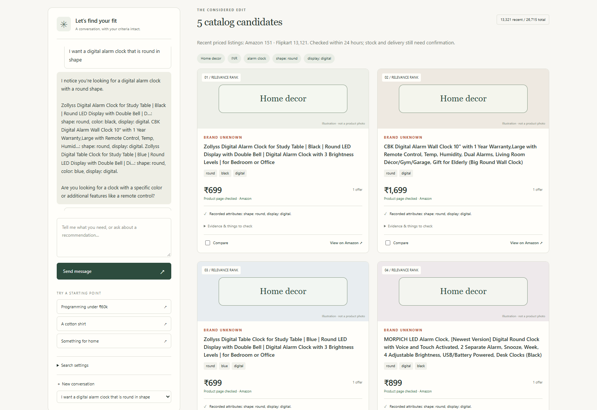
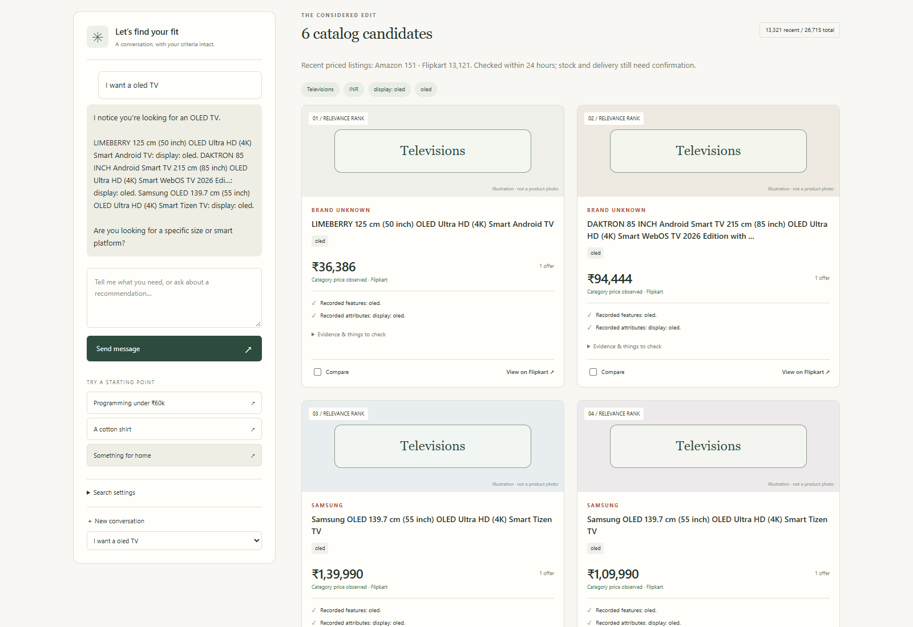
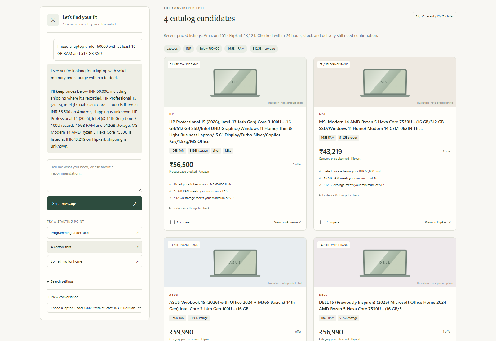
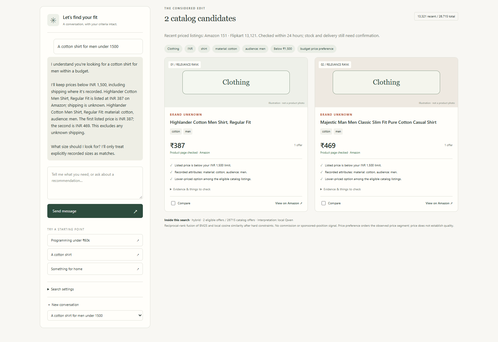

# Search examples and screenshots

These are actual browser captures from the populated development app on **31 October 2026**, using local Qwen and hybrid retrieval. Product cards and replies were not mocked or rewritten for the images. Screenshots show the visible portion of each result list; open an image to inspect the text at full resolution.

The capture checks verify both the saved requirements and returned product fields. This demonstrates the recorded behavior of these examples, not universal language understanding or independently tested product quality. Prices and availability can change. The interface uses clearly labeled illustrations/category placeholders rather than product photographs.

## 1. A round digital alarm clock

**Request:** “I want a digital alarm clock that is round in shape”

**Follow-up:** “Nothing else, just show me the options”

The search preserves `alarm clock`, `shape: round` and `display: digital`. The captured run returned five Amazon candidates. The confirmation continues the existing brief rather than turning “Nothing” into a brand restriction.



## 2. An OLED television

**Request:** “I want a oled TV”

The request becomes a television search with a recorded OLED display requirement. The captured run returned six Flipkart candidates. The extraction and matching fields agree, so OLED is checked as a specification rather than treated as an unsupported sentence. These remain retailer-recorded display claims, not independent panel verification.



## 3. A laptop within a budget and minimum specifications

**Request:** “I need a laptop under 60000 with at least 16 GB RAM and 512 GB SSD”

The shortlist applies a strict price ceiling below ₹60,000, at least 16 GB RAM and at least 512 GB storage. Four candidates were returned across Amazon and Flipkart. Known shipping is included in the budget check; unknown shipping remains disclosed rather than treated as a guaranteed delivered price.



## 4. Men's cotton shirts

**Request:** “A cotton shirt for men under 1500”

This example combines a clothing subtype, material, audience and a strict price ceiling below ₹1,500. Only recorded cotton and men's-audience attributes can satisfy those requirements. A missing selected size or uncertain stock is not implied to be verified.



## Reproduce the captures

Follow [Setup](SETUP.md), populate and index a recent catalog, start the local app, and run:

```powershell
node scripts/capture_showcase.cjs
```

The script needs Playwright and installed Chrome. An optional example ID, such as `cotton-shirts`, captures just that scenario. A future run can return different offers or fail if current inventory does not meet the requirements. It will not fabricate products to recreate these images.

The development catalog and saved chats are not included in this repository. The application source, collection tools and documented import format are provided so a new catalog can be built separately.
